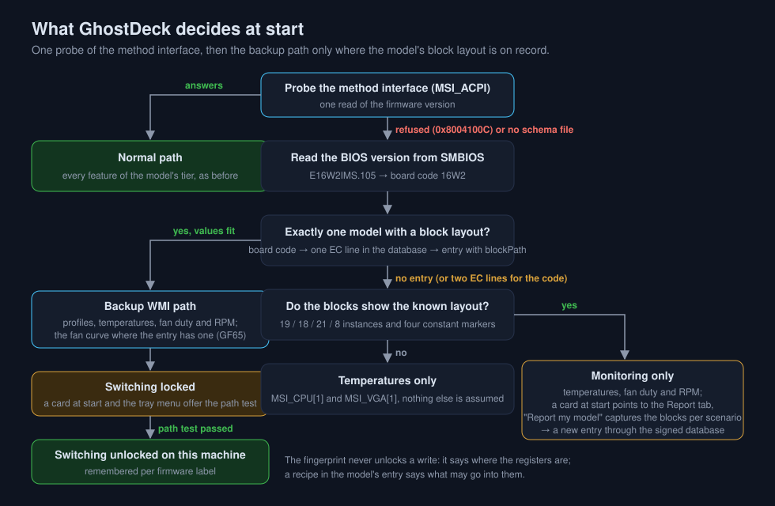
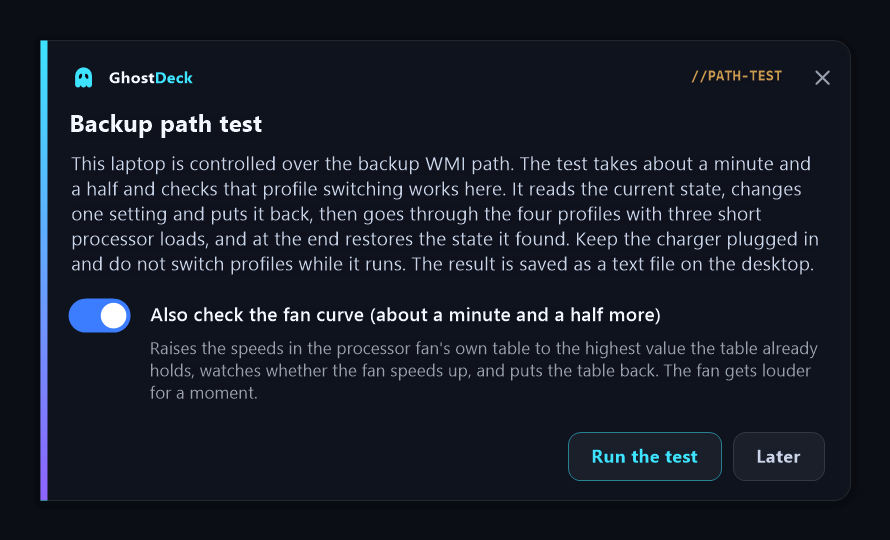
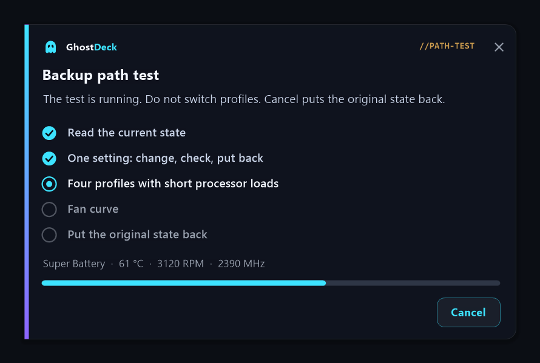
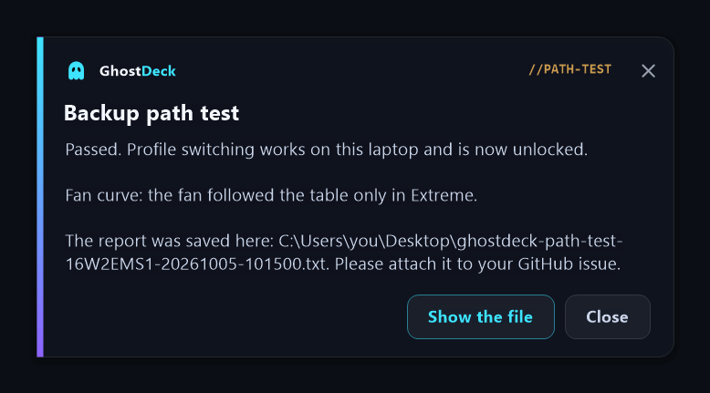

# Older MSI laptops: the backup WMI path

> *Unofficial project - not affiliated with or endorsed by MSI. "MSI", "MSI Center" and "Dragon Center" are trademarks of Micro-Star International, used here descriptively only.*

This page is for owners of MSI laptops from the **Dragon Center generation** (roughly 2018 to 2021: Delta 15, GF65 Thin, GF63 Thin, GS75, GE75, GP75, Alpha 15, Bravo 15 and their relatives). On many of them GhostDeck used to show temperatures and nothing else. Since the backup WMI path exists, a growing number of them get profiles too. The first part explains in plain words what is going on and what to do. The last part is for readers who want the technical detail.

---

## 1. What is going on

Every MSI laptop has a small controller chip that holds the power profile and the fan mode. GhostDeck normally talks to it through an **interface** that MSI's own software uses too: a list of commands the firmware offers to Windows ("read this register", "write this value there"). On newer laptops that interface exists and GhostDeck uses it for everything.

On the Dragon Center generation the firmware **does not offer that interface at all**. Every command is refused, on every machine of that generation, whatever MSI software is installed. This is not something a reinstall, a driver or a setting fixes: the firmware simply never had it. (A different case, a clean Windows install that lacks one MSI file, is covered in the [FAQ](FAQ.md#ghostdeck-worked-before-but-after-a-clean-windows-install-it-says-unsupported-is-my-laptop-no-longer-supported).)

The same firmware does offer something else: **data blocks**. Think of them as a set of numbered boxes that Windows can read, and some of which Windows can write. Temperatures, fan speeds, the power profile and the fan mode each sit in a box. GhostDeck can work through those boxes instead of the interface. That is the **backup WMI path**.

The catch: the firmware decides which box is which, and the numbering is **not** the same thing as the register addresses GhostDeck knows from newer machines. So GhostDeck only uses the boxes on a model where somebody has checked, box by box, where everything is. That record is kept per model in the signed model database, and the owner of each model adds it with a report from the app.

## 2. What you will see

GhostDeck checks the interface once at start. When it is refused, one of three things happens, depending on whether your model's block layout is on record.

### 2a. Your model is on record: the backup path

Today that is the **GF65 Thin 10UE** (a tested model since 18 October 2026, the first of this generation), the **Delta 15 A5EFK** and the **GS66 Stealth** (board `16V1`, since 20 October 2026). Status names your model, shows the firmware as the EC line and the BIOS version it was read from (for example `16W2EMS1 (BIOS E16W2IMS.105)`), and carries a note that the laptop works over the backup path.

Temperatures, fan duty and fan RPM work right away. **Profile switching starts locked.** It unlocks after the **path test** (next section) has passed on your machine. Until then the profile tiles, hotkeys and the tray menu are there but refuse to switch, and the status badge says so.

On this path a few things are not available, because they would need boxes nobody has mapped yet: **Fan Boost, the charge limit, the keyboard backlight and the webcam switch**. The fan-curve editor is available where the model's entry has a verified curve, today the GF65 Thin 10UE.

### 2b. Your model is not on record, but the blocks look familiar: monitoring only

Three boards of three generations (Delta 15, GF65 Thin 10UE, GS75 Stealth 8SE) turned out to have exactly the same block layout. When your laptop's blocks look the same, GhostDeck trusts them for **reading**: Status shows the temperatures, the fan duty and the fan RPM, and the badge says *monitoring only*. Nothing is written.

A card at start tells you what unlocks more: one report.

### 2c. Neither: temperatures only

When the blocks do not look like the known layout, GhostDeck shows the CPU and GPU temperature from the two boxes it is sure about and nothing else. The diagnostic package (Settings → System → Diagnostics) lists every block in full, which is what a new layout is worked out from.

## 3. What to do

### If your model is on record: run the path test

The test proves, on your machine, that switching profiles through the blocks really works, and then unlocks it. It is offered as a card at start and sits in the tray menu as **Backup path test…**.

1. Plug in the charger and close games or heavy programs.
2. Press **Run the test**. Leave the switch *Also check the fan curve* on if you can spare a minute and a half more and do not mind the fan getting loud for a moment.
3. Do not switch profiles while it runs. The card shows the stage it is at; **Cancel** puts the original state back.

4. Read the result. **Passed** means switching is unlocked on this machine from now on. **No reaction** means the bytes went in but the processor did not slow down in Super Battery; switching stays locked and the report has the raw numbers.

5. The report is a text file on your desktop, `ghostdeck-path-test-<firmware>-<date>.txt`. Please attach it to the issue for your model (for the GF65 Thin 10UE that is [#230](../../../issues/230), for the Delta 15 [#48](../../../issues/48), for the GS66 Stealth [#258](../../../issues/258)) or open a new one. One report per model is what tells us whether the layout holds on more than one machine.

The whole run takes about a minute and a half, about three minutes with the fan-curve check. Every value the test changes is put back at the end; if the run is interrupted, GhostDeck puts the values back at its next start.

### If the badge says monitoring only: send one report

1. Open the **Report** tab (the card at start takes you there, or tray menu → *Report my model…*).
2. Follow the steps: switch your MSI app (Dragon Center or MSI Center) to each scenario it offers and press **Capture** after each one. On this kind of laptop the capture reads the data blocks instead of the controller's memory. If your app has only three of the four scenarios, capture the three and say which one is missing.
3. Let the wizard open the pre-filled GitHub issue and submit it.

The report shows which boxes change between scenarios. From that, the model's entry (which box is the profile, which the fan mode, which values each scenario uses) is written and shipped through the signed model database, so your laptop starts working with the next database update, without a new release.

### If Status shows temperatures only

Open an issue with the diagnostic package (Settings → System → Diagnostics → *Create package*). The file `msi-wmi-blocks.txt` inside lists every block the firmware serves; that is the starting point for a new layout.

## 4. Safety

- GhostDeck never loads a driver and never touches the controller directly; both paths go through Windows's own ACPI-WMI mapper.
- On the backup path there is exactly one function that writes, and it checks three things every time: the test is running or has passed on this machine, the box is on the allow-list of the model's entry, and the value is one the model's own profiles use. Anything else is refused.
- The path test writes only the fan mode, the shift mode and, in the optional curve check, the speed values of one fan's table, raised to a value the table already contains. Temperature thresholds are never written.
- The original values are saved to a file before the first write and restored at the end, or at the next start if the run was interrupted.
- A pass is remembered for the firmware it was earned on. A settings file imported from another machine does not bring a pass with it.

---

## 5. Technical section

Readers who want the full write-up with the measurements will find it in [TECHNICAL.md §81](TECHNICAL.md#81-the-backup-wmi-path-data-blocks-when-the-method-interface-is-refused-issues-48-117-230); §39 covers the monitoring-only mode it grew from. This section is the condensed version with diagrams.

### 5.1 Two WMI surfaces, one controller

MSI exposes its embedded controller to Windows through ACPI-WMI, the mechanism where the firmware publishes a `_WDG` table of GUIDs and Windows's `wmiacpi.sys` turns each GUID into a WMI class in `root\wmi`. There are two kinds of entry in that table, and the two laptop generations ship different ones:

| | Method interface (the normal path) | Data blocks (the backup path) |
|---|---|---|
| WMI class | `MSI_ACPI`, methods `Get_Data` / `Set_Data` | `MSI_System`, `MSI_CPU`, `MSI_VGA`, `MSI_AP` (and more) |
| What a call carries | a 32-byte buffer: byte 0 = EC register address, byte 1 = value | one instance per index: `ACPI\PNP0C14\0_N`, value in a property named after the class |
| Firmware side | one ACPI method that reads or writes a register by address | one read routine (`WQxx`) and one write routine (`WSxx`) per block, with the firmware's own table from index to register |
| How GhostDeck names a register | by address: `0xD4` | by block and index: `MSI_System[9]` |
| Dragon Center generation | absent from `_WDG`; every call answers `0x8004100C` | served |
| Newer generations (e.g. GE78HX) | served | `MSI_CPU` and friends answer `0x8004100C` |

The second and third rows are the reason for the hard rule of this path: **a slot is addressed as block[index], recorded per model, and never derived from an EC address.** On the Delta 15, whose firmware table the owner decoded, `MSI_CPU[3]` is register `0x70` while `MSI_CPU[5..10]` are `0x6A..0x6F` and `MSI_AP[2]` is `0xCD`; the order of indices has nothing to do with the order of addresses.

### 5.2 The block layout on record

Three machines of three generations returned the same instance counts and the same slots (GhostDeck's own diagnostic packages, attached to #48, #117 and the GS75 survey):

| Slot | Meaning |
|---|---|
| `MSI_System[7]` | shift mode (`0xC1` comfort, `0xC4` turbo, `0xC2` eco - the same values as on the method interface) |
| `MSI_System[9]` | fan mode (`0x0D` auto, `0x1D` silent preset, `0x8D` advanced) |
| `MSI_CPU[1]`, `MSI_VGA[1]` | temperature, °C |
| `MSI_CPU[2]`, `MSI_VGA[2]` | fan duty, % |
| `MSI_CPU[4]`, `[5..10]`, `[11..17]` | fan-curve table: a 0-degree anchor, six thresholds, seven speeds (`MSI_VGA` the same for the GPU fan) |
| `MSI_AP[2]`, `MSI_AP[4]` | CPU / GPU tachometer; RPM = 478000 / value, 0 = stopped |

The layout fingerprint GhostDeck uses to recognise this layout on a machine without an entry: 19 instances in `MSI_CPU`, 18 in `MSI_VGA`, 21 in `MSI_System`, 8 in `MSI_AP`, and four constant markers (`MSI_CPU[0]` = 13, `MSI_System[1]` = 2, `MSI_System[19]` = 226, `MSI_AP[1]` = 20). `MSI_System[11]` is not one of them: on the GS66 Stealth of #268 it follows the scenario (Silent 5, Balanced 3, Extreme 2, Super Battery 5). The fingerprint only ever enables reading.

### 5.3 Naming the model without the EC version

The EC version string cannot be read on this path, so the model is named from the SMBIOS BIOS version. MSI BIOS versions read `E` + a four-character board code + a platform letter + `MS` (`E16W2IMS.105`), and the EC line of the same board starts with the same four characters (`16W2EMS1`). GhostDeck takes the backup path only when the board code maps to **exactly one** EC line in the database, that entry has a block layout, and the live values fit the layout (shift byte in the `0xC0` range, fan-mode byte ending in `D`, a plausible CPU temperature). A board with two EC lines, such as the GS75's `17G1` (`17G1EMS1` / `17G1EMS2`), stays unidentified and lands in monitoring only.

### 5.4 Writes and the gate

One function writes on this path, and it refuses anything that fails one of three checks: the gate is open, the slot is on the allow-list, the value is on that slot's list. The gate opens for the duration of the path test and stays open on a machine where the test has passed (stored per firmware label, not imported with settings). The allow-list is built from the model's entry: the shift-mode and fan-mode slots with the values its four profiles use; the curve slots and the advanced fan-mode value where the entry has a curve; and, during the test, the original values it has to put back. The transport is a WMI `Put()` on the instance found by index, which makes Windows call the block's write routine with the index and the value.

### 5.5 The path test

The pass criterion compares work done, not bytes stored: the same synthetic all-core load the power test uses runs for 20 s in Extreme, Super Battery and Extreme again, the first 5 s of each are not counted (a processor may exceed its sustained limit for the first seconds in any mode), and the run passes when Super Battery delivers at most 90 % of the slower Extreme run. The line sits between the noise of two runs of the same mode (a few percent, up to 5 % seen on a busy machine) and the cost a power-saving mode is expected to have (tens of percent). Running Extreme on both sides of Super Battery keeps a machine that merely warmed up or cooled down from looking like a reaction. The known risk is on boards whose power limits take hold slowly: the test can report no reaction where switching works. That outcome locks the feature and leaves the raw shares in the report, from which the verdict can be judged and the criterion adjusted; the opposite error, unlocking a machine that does not react, is far less likely.

The optional fan-curve check raises every speed slot of the CPU fan's table to the highest value the table already holds, sets the fan mode to advanced, and watches the tachometer for 40 s in the comfort shift mode and 40 s in the turbo one. A rise of 500 RPM over the baseline counts as the fan following the table. Its verdict never changes the verdict of the test; it decides whether the curve editor is offered on that model.

### 5.6 Results so far

| Machine | Firmware | Result |
|---|---|---|
| GF65 Thin 10UE (owner, #230) | `16W2EMS1`, BIOS `E16W2IMS.105` | two runs on 8 October 2026, with and without Windows turbo boost: **passed** (Super Battery at 52 % and 34 % of Extreme), restore confirmed, the fan followed the raised table in both phases. Curve editor enabled for the model. On 18 October the owner confirmed that Silent is audibly quieter than Balanced and that switching stayed stable over days, and the entry was promoted to **tested**. |
| Delta 15 A5EFK (#48, discussion #241) | `15CKEMS1` | layout on record from the diagnostic package; no run on hardware yet. The owner's own measurement says the firmware follows the curve table only outside the two power-saving shift modes. |
| GS66 Stealth 10SF (#258), GS66 Stealth (#268) | `16V1EMS1`, BIOS `E16V1IMS.112` | layout on record since 20 October 2026, from the first owner's block report (every fingerprint marker). Recipes from msi-ec; switching Dragon Center scenarios moved neither the shift nor the fan slot in his capture. A second owner's capture (#268, Dragon Center 2.0.149) moved both slots exactly to the entry's values: shift `C1`/`C1`/`C4`/`C2` and fan `1D`/`0D`/`0D`/`0D` for Silent, Balanced, Extreme and Super Battery. No path test on hardware yet. |
| GS75 Stealth 8SE | board `17G1` | blocks served in the same layout, firmware without `MSI_ACPI`; stays in monitoring only until the EC line can be told apart. |
| GS63VR 7RG Stealth Pro (#257) | board `16K3`, BIOS `E16K3IMS.116` | blocks served with the same instance counts and the four markers; `MSI_System[11]` read 3, which kept the laptop in temperatures only while that slot was part of the fingerprint. Without it the laptop is recognised for reading (monitoring only). In the owner's report the shift slot (`MSI_System[7]` = `0xC3`) and the fan slot (`MSI_System[9]` = `0x0C`) kept the same value in all four scenarios, so no recipe can be read from it. Asked whether switching scenarios changes anything audible and for the diagnostic package. |

### 5.7 For developers

- The layout travels in the model database as an optional `blockPath` object per model (slots as `"MSI_System[7]"`, curve tables as class / tempFirst / speedFirst / count); older clients ignore the key.
- `msi-wmi-blocks.txt` in the diagnostic package lists eight blocks in full with timings, the value property's type and `write` qualifier, and the block routine names found in the firmware table.
- `MSIPS_BLOCKS_FILE=<msi-wmi-blocks.txt>` with `MSIPS_BLOCKS_BIOS=<version>` replays a saved dump instead of querying WMI; writes land in the in-memory copy, `MSIPS_BLOCKS_STUCK=1` makes the copy ignore them. Every stage of the test, including a firmware that ignores writes, has been run this way against the dumps of all three machines.
- Source: `Core/EcBlocks.cs` (transport, fingerprint, dump), `Core/Ec.cs` (path detection, the gate), `Core/BackupPathTest.cs` (the test), `Forms/BackupTestForm.cs` (the cards), `UI/ReportPage.cs` (block capture in the report wizard).
