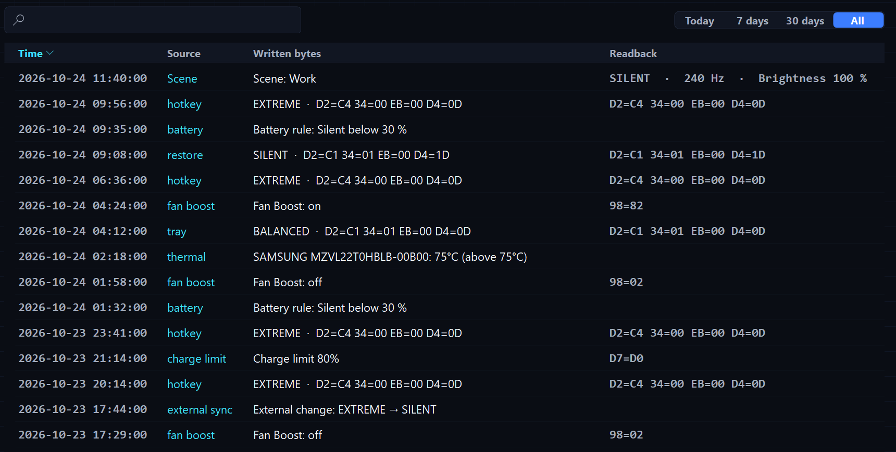
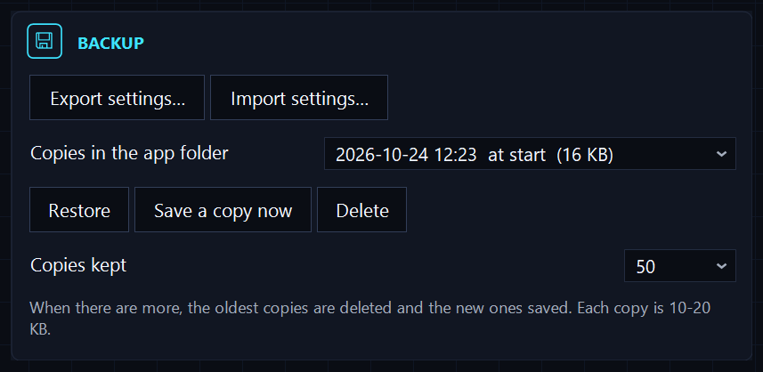
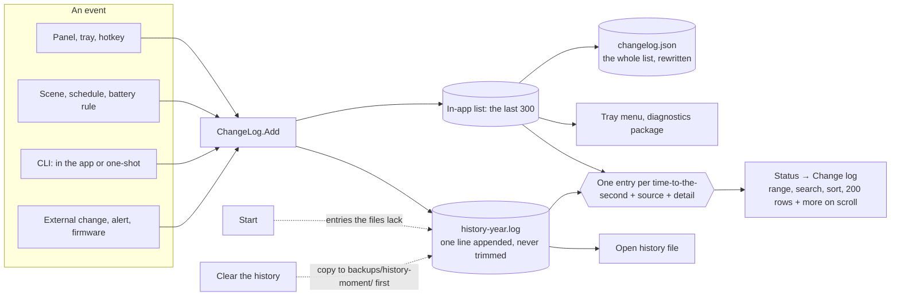

# The change history: where it lives, what the Change log tab shows, how to clear it

GhostDeck writes down every change it makes or notices: a profile switch (from the panel, the tray, a hotkey, a scene, a schedule, a battery rule, the command line, or the restore at start), the charge limit, Fan Boost, a fan curve, a change made outside the app, a temperature alert, a refresh-rate switch, a firmware event, a power test. This page says where those entries are kept, what the **Status → Change log** tab shows, and what *Clear the history* does. For the registers behind the entries see [TECHNICAL.md](TECHNICAL.md) (§19.7 and §24).



## Three places, one content

Everything lives in the app's own folder, `%AppData%\GhostDeck` (that is `C:\Users\<you>\AppData\Roaming\GhostDeck`).

| File | What it is | Limit |
|---|---|---|
| `changelog.json` | The working list: the last **300** entries. The app keeps this list in memory while it runs and writes it back on every new entry; the tray menu and the diagnostics package use it. | 300 entries; the 301st pushes the oldest out |
| `history-<year>.log` | The **complete** history: one line per entry, appended, never trimmed. One file per year. | none |
| `errors.log` | The technical log: errors and notes (updates, refused imports, settings copies, an unreadable settings file). | 128 KB, then it starts over |

A new entry goes to all of them at once: to the list in memory (and so to `changelog.json`) and as one line to `history-<year>.log`. A command run with no app running (`GhostDeck.exe --profile silent`) writes the same way.

The line in the history file has four fields separated by tabs: the time to the second, the source (the name from the code, not translated), the detail and the readback:

```
2026-10-24 12:50:01	Scene	Scene: Work	SILENT  ·  240 Hz  ·  Brightness 100 %
2026-10-24 12:58:22	ChargeLimit	Charge limit 80%	D7=D0
```

The detail is in the language the app had at the time; the file is a record, it is not translated afterwards.

**The first start of a version that keeps the file** also writes into it every entry the app still remembers from before the file existed (up to 300), oldest first, so the file is complete from day one. Later starts add nothing.

## What the Change log tab shows

The tab shows the **sum** of the list in memory and every `history-*.log` file, each entry once (an entry in memory carries milliseconds, its line in the file seconds; they count as one), newest first.

Above the table:

- the **range**: today, 7 days, 30 days, all;
- the **count**, "200 of 1532 entries", which also tells you more is to come;
- the **search** field, which filters as you type over the time, the source, the detail and the readback;
- the buttons **Copy shown** (the rows on screen, as text), **Open history file** (this year's file in your text viewer) and **Clear the history**.

A click on a column header sorts (time newest first by default, text columns A to Z; a second click reverses). Rows alternate two tints and light up under the mouse. The newest 200 rows draw first; when you scroll to the last one, the next 200 come in on their own, so a history of thousands of entries never draws at once and there are no pages to turn.

While the tab is on screen, new entries appear as they happen; the files are read once, when the tab opens.

## Clear the history

*Clear the history* asks first. Then the app **copies** `changelog.json` and every `history-*.log` to a folder of its own under the app's backups, `backups\history-<date-time>\`, and only after a successful copy deletes the files and empties the list. A copy that fails clears nothing. The card at the end names the folder. Those folders are small and stay; the app never deletes them.

## The backups folder

The same `backups\` folder also holds the copies of your settings (Settings → System → Backup): one at start whenever a preference changed, one before every import or restore, one when you click *Save a copy now*, and one of a settings file the app could not read. You choose how many of those stay (50 to 150); the oldest go when there are more. The history copies above are separate folders and are not counted.

```
%AppData%\GhostDeck\
├── settings.json                 your settings
├── settings.json.bak             the previous settings file
├── changelog.json                the last 300 entries
├── history-2026.log              the complete history, 2026
├── errors.log                    the technical log
└── backups\
    ├── settings-20261024-122314-start.json
    ├── settings-20261024-121759-import.json
    ├── settings-20261024-121704-manual.json
    └── history-20261024-131500\      a copy made by Clear the history
        ├── changelog.json
        └── history-2026.log
```



## The diagnostics package

*Save diagnostics package* (Settings → System) zips `settings.json`, `changelog.json` and `errors.log` with a read-only EC dump, the WMI blocks and the version. It does **not** include `history-*.log` or the backups folder: the last 300 entries are what a report needs. If a report ever needs the full history, *Open history file* shows where it is.

## How an entry flows



## Questions people ask

**The list shows entries from only the last few days.** Before 1.42 the app kept 300 entries and nothing more; a busy week fills them. From 1.42 the file keeps everything, and the tab reads the file.

**The history file has fewer lines than the tab shows.** The file starts with the first start of 1.42 and is completed from memory at that moment; the tab also shows the entries that were in memory. After that start they match.

**Can I edit the file by hand?** You can read it anywhere; if you edit it, keep the four tab-separated fields on every line, or the app skips that line.
