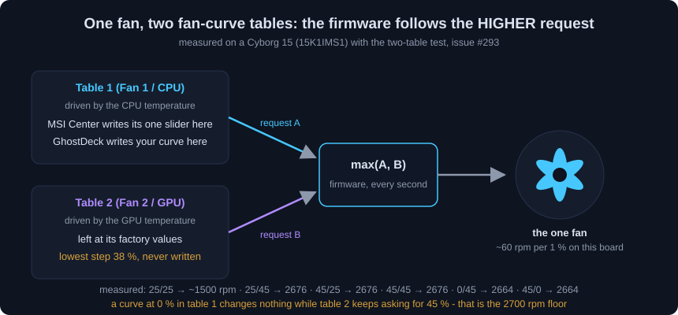
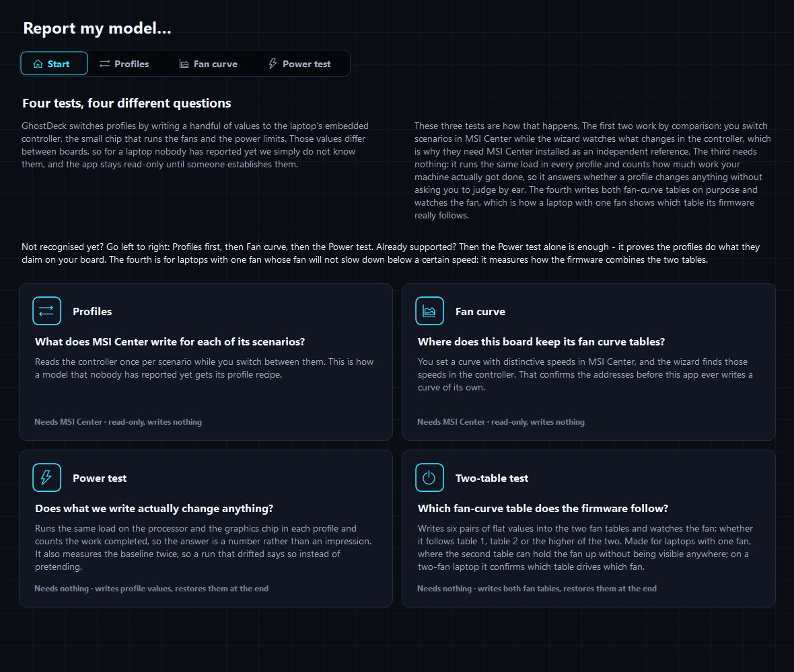
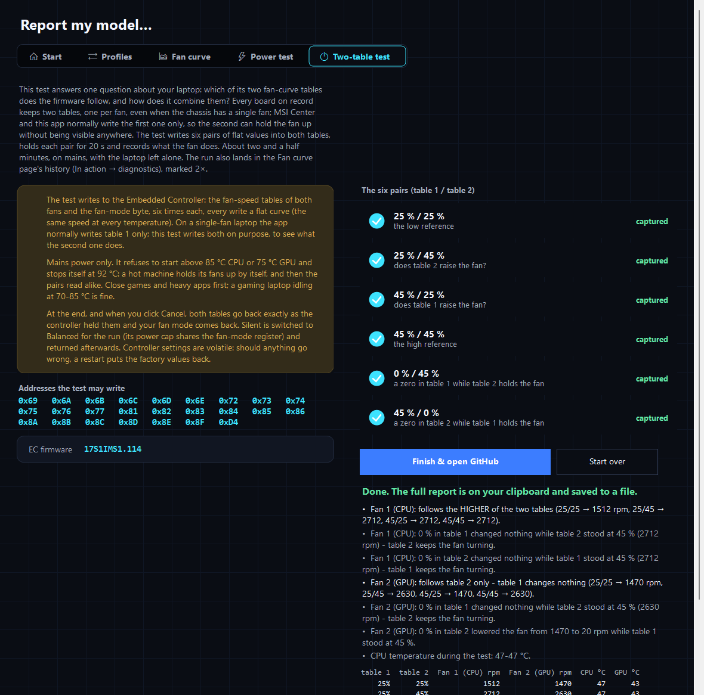
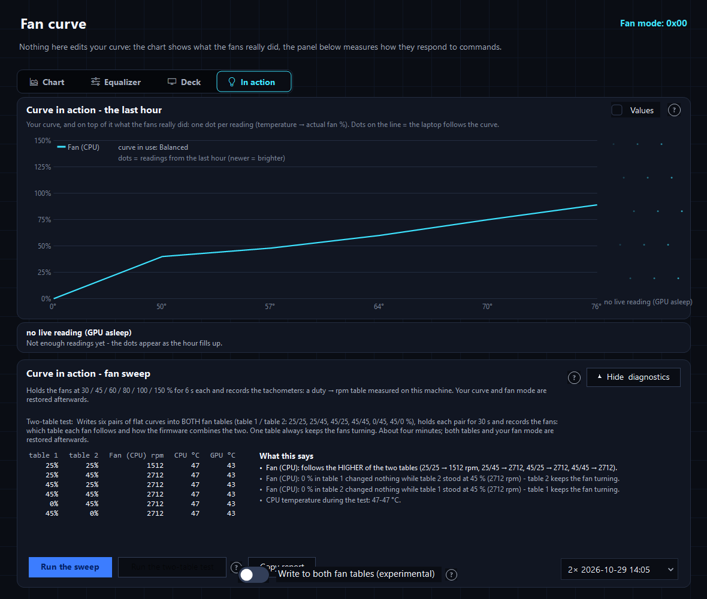
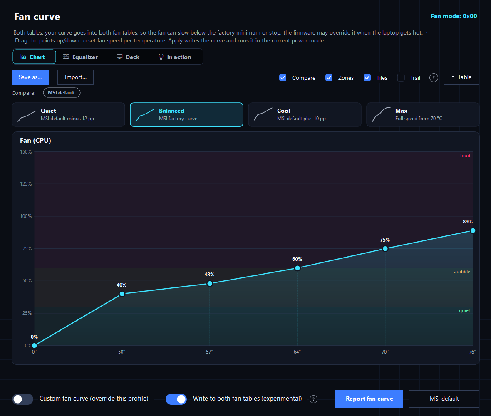
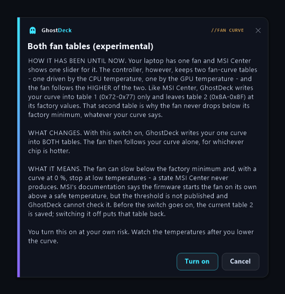

# One fan, two fan-curve tables

Why a single-fan MSI laptop can refuse to slow its fan below a certain speed, how GhostDeck
measured it, and the two things the app offers about it: the **two-table test** and the
**"write to both fan tables" switch** (experimental, opt-in). Plain language first, the
technical part at the end. Issues [#224](../../../issues/224) and [#293](../../../issues/293).

---

## 1. The short version

Every MSI laptop GhostDeck knows keeps **two fan-curve tables** in its controller: one for
"Fan 1", driven by the CPU temperature, and one for "Fan 2", driven by the GPU temperature.
That is true even on a laptop with **one physical fan** - the Cyborg 15 family, the Thin GF63 /
Thin 15, the Modern 14 C12M, the Summit E14 Flip. On such a laptop the one fan listens to
**both** tables and runs at whichever of the two asks for more.

MSI Center shows one slider on these laptops and writes it into table 1 only. Table 2 keeps its
factory curve, whose lowest step is about 38 %. GhostDeck does the same by default. The
consequence: however low you drag your curve, the fan never goes below what table 2 asks for
at the current GPU temperature - on a Cyborg 15 that is roughly 2700 rpm at idle.

GhostDeck gives you two things about it:

- **The two-table test** measures, on your own laptop, which table the fan follows and how the
  firmware combines the two. It has its own sub-tab on the *Report my model* page (the fourth
  card on its start screen), with the explanation, the progress, the result and a GitHub form
  for the report; the same run is also on the Fan curve page's In action view, next to the sweep.
- **The "write to both fan tables" switch** (experimental) makes GhostDeck write your one curve
  into both tables, so the fan follows your curve alone and can slow below the factory minimum,
  or stop. It is off by default, lives behind a consent card, and switching it off puts the
  original table 2 back.

## 2. How it was found

The owner of a Cyborg 15 A13VE reported in [#224](../../../issues/224) that, after the model's
entry was marked as single-fan (so the app stopped writing table 2), his fan would not drop
below ~2700 rpm even with the curve at 0 %. Before that change he could bring it to ~1900 rpm
and to a stop by lowering the second curve the editor used to show.

Two captures from the same laptop settled it ([#293](../../../issues/293)):

1. **MSI Center at its lowest setting** (a read-only capture): MSI Center lets you take table 1
   all the way to 0 % and leaves table 2 at its factory values. The floor is that untouched
   second table, not a limit MSI Center enforces in its interface.
2. **The two-table test** (below): the fan sat at the same ~2680 rpm for 25/45, 45/25 and
   45/45, and 0 % in either table changed nothing while the other stood at 45 %. The fan
   follows the **higher** of the two tables.

The same capture also showed that this board reports its fan speed as a 16-bit pair; a 25 %
flat curve read as an impossible 7468 rpm through the single-byte address the entry used to
carry, and as ~1500 rpm through the pair - exactly 25 % at the board's ~60 rpm per percent.
The entry was corrected in the model database.

## 3. The two-table test

**What it answers:** which fan-curve table does the firmware follow, and how does it combine
the two?

**Where:** *Report my model* → **Two-table test** (the fourth card on the start screen, or the
sub-tab of the same name). The sub-tab has the explanation, the six pairs with what each one
separates, a consent box, the run with its progress, the result, and a button that opens the
GitHub form with your report. The same run also sits on the Fan curve page: **In action** →
**Show diagnostics** → **Run the two-table test**, next to the fan sweep, where the result is
drawn in the diagnostics panel and the picker keeps every run.

**What it does:** writes six pairs of flat curves into the two tables - 25/25, 25/45, 45/25,
45/45, 0/45 and 45/0 % (table 1 / table 2) - holds each pair for 20 seconds and records the
fan. One table always keeps the fan turning; the pairs never put 0 % in both. At the end both
tables and your fan mode are restored, and the run lands in the same history as the fan
sweep, marked 2×. The Report sub-tab copies the report to your clipboard, saves it on your
Desktop and opens the **Two-table test result** form on GitHub with the model, the firmware
and the verdict already filled in.

**How to read it:** if 25/45 and 45/25 both spin like 45/45, the fan follows the higher of the
two tables. If 25/45 spins like 25/25, it follows table 1 only. The zero pairs say what a 0 %
in one table does while the other holds the fan. On a two-fan laptop the same run confirms
which table drives which fan.

**Safeguards:** mains power only; the test refuses to start above 85 °C CPU or 75 °C GPU (a
hot laptop holds its fans up by itself, and then the pairs read alike; a gaming laptop idling
at 70-85 °C is fine) and stops itself at 92 °C. Each pair is held for 20 seconds, so the whole
run takes about two and a half minutes. Every address it writes is listed before you start,
and the consent says in so many words that on a single-fan board the app normally writes
table 1 only.

**What it is usually for:** a single-fan laptop whose fan will not slow down below a certain
speed - run the test before touching the switch below, so the decision rests on your own
board's numbers. On a two-fan laptop it is a quick confirmation that each table drives the
fan it is named after.

## 4. The "write to both fan tables" switch

Off by default. It appears on the Fan curve page, next to the curve switch, only on laptops
whose entry is marked single-fan.

Before it goes on, a card explains four things: how the writes have been done until now, what
changes, what it means for the fan, and that you turn it on at your own risk.

**What changes with the switch on:** every curve write - Apply, a preset assigned to a profile,
the command line, the fan sweep - puts your one curve into **both** tables. The fan then follows
your curve alone, for whichever chip is hotter.

**What it means:** the fan can slow below the factory minimum and, with a curve at 0 %, stop at
low temperatures - a state MSI Center never produces. MSI's own documentation says the firmware
starts the fan on its own above a safe temperature, but the threshold is not published and
GhostDeck cannot check it. Watch the temperatures after you lower the curve.

**Switching it off:** the moment the switch went on, GhostDeck saved table 2 as the controller
held it. Switching off writes that table back, so the board is exactly as it was before - not
left with the last mirrored curve in its second table.

**Why experimental:** the rule "the fan follows the higher table" has been measured on one
board so far (the Cyborg 15 A12VF / A13VF / A13VE). On another single-fan model, run the
two-table test first; if your fan follows table 1 only, the switch changes nothing for you.

## 5. Technical notes

- Tables on the modern layout: Fan 1 temperatures `0x6A`-`0x70`, speeds `0x72`-`0x78`; Fan 2
  temperatures `0x82`-`0x88`, speeds `0x8A`-`0x90`; seven points, the editor shows six. The
  firmware applies thresholds stepwise, without interpolation, and reads the tables only in
  Advanced fan mode (`0xD4` = `8D`).
- The duty bytes `0x71` / `0x89` are the per-table requests; the tachometer tells what the fan
  did. The test's verdict compares tachometer readings across the pairs (two readings within
  8 % or 100 rpm count as the same speed; the high pair must be at least 15 % or 150 rpm above
  the low one, otherwise the run is reported as *flat*).
- The switch is stored per firmware prefix in the settings (`BothTablesFw`), with the saved
  table 2 next to it (`Fan2TableBackup`). It is not a model-database flag: the entry says only
  that the board has one fan and one slider.
- With the switch on, `Ec.WriteFanCurve` copies the Fan 1 temperatures and speeds into the Fan
  2 tables for every normal write. The two-table test writes its own pairs regardless of the
  switch and restores both tables afterwards.
- Observation without a conclusion: under MSI Center's all-zero curve the fan-mode byte read
  `9D` on the Cyborg 15 (`8D` otherwise).
- Code: `Core/TwoTableTest.cs`, `Core/Ec.cs` (`WriteFanCurve`, `MirrorToFan2`),
  `UI/FanCurvePage.cs`. More in [TECHNICAL.md §85](TECHNICAL.md#85-two-fan-curve-tables-on-a-single-fan-board-and-the-two-table-test-issues-224-293-2026-10)
  and [FAN-CURVE.md §7a](FAN-CURVE.md#7a-the-two-table-test).
